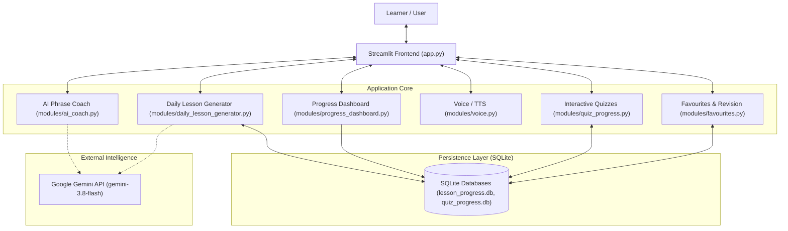

# 🌿 NammaSahaaya AI — Kannada Made Simple

> **A real-world, bilingual Kannada language companion built for Tamil- and English-speaking newcomers living, working, and commuting in Karnataka.**

---

## 📌 Problem Statement

Every year, hundreds of thousands of professionals, students, and workers move to Bengaluru and other parts of Karnataka. Despite good intentions, navigating daily interactions presents significant friction:
- **Everyday Language Barriers**: Commuting via autos or buses, negotiating at local grocery shops, ordering food at darshinis, or explaining urgent issues at clinics.
- **Cognitive Overload**: Conventional language learning apps focus on academic grammar or rote script drills rather than practical, situational phrases needed right away.
- **Lack of Immediate Help**: In fast-moving or stressful situations, users need instant phrase translation explained in a language they already understand (Tamil or English), with natural pronunciation and offline resilience.

**NammaSahaaya AI** bridges this gap with situational learning, offline resilience, and daily learning progression.

---

## 👥 Target Users

1. **New Residents & Commuters**: Non-Kannada speakers who recently relocated to Bengaluru or Karnataka for work or education.
2. **Tamil- & English-Speaking Learners**: Learners who benefit from dual explanations (English for general clarity, Tamil for linguistic proximity and cultural familiarity).
3. **Daily Commuters & Shoppers**: Anyone needing immediate phrases for autos, buses, markets, restaurants, and medical emergencies.

---

## 🚀 Key Features

| Feature | Description | Resilience / Fallback |
|---|---|---|
| **🤖 AI Phrase Coach** | Conversational coach powered by Google Gemini (`gemini-3.8-flash`). Translates real-life requests into practical spoken Kannada with Romanized transliteration and Tamil/English explanations. | Graceful fallback to verified phrasebook entries if Gemini is unreachable or rate-limited. |
| **🎭 Situation Simulator** | Interactive scenario-based practice across 5 key everyday domains (Shopping, Transport, Restaurant, Hospital, and General Help). | Uses curated scenario dialogues with audio pronunciation. |
| **🆘 Rescue Mode** | Instant emergency Kannada phrasecards designed for high-stress situations (medical, police, directions, lost items). | **100% offline & API-free**. Works instantly without internet or LLM dependencies. |
| **📚 Phrasebook** | Categorized, searchable library of practical everyday Kannada phrases with English and Tamil meanings. | Built-in dataset with audio playback. |
| **⭐ My Favourites & Revision** | Personal phrase bookmarking with flashcard **Revision Mode** to test active recall. | Saved phrases persist permanently in SQLite across restarts. |
| **📖 Daily Kannada Lessons** | 8 foundational curated lessons with learning objectives, practical phrases, pronunciation audio, and speaking activities. | Full offline availability with persistent completion tracking. |
| **📅 Automatic Daily Lessons** | Automatic daily Kannada lesson generation for each calendar date (`Asia/Kolkata`). Generated on demand when the app is opened on a new date. | Persisted in SQLite. If Gemini is unavailable, deterministically selects an authentic curated lesson labeled as a fallback. |
| **🎯 Interactive Quizzes** | 5-question scenario quizzes testing everyday comprehension. Answers can be saved directly to Favourites. | Full attempt and score tracking in SQLite. |
| **📊 Learning Progress Dashboard** | Analytics dashboard displaying curriculum completion percentage, quiz performance over time, topic mastery analysis, and rule-based next-step recommendations. | Read-only SQLite queries; transparently distinguishes curated vs daily lessons. |

---

## 🛠️ Technology Stack

- **Frontend & UI**: [Streamlit](https://streamlit.io/) (Python web framework)
- **AI & NLP**: [Google Gemini SDK](https://github.com/google-gemini/generative-ai-python) (`google-genai`, model `gemini-3.8-flash`)
- **Speech & Audio**: [gTTS](https://pypi.org/project/gTTS/) (Google Text-to-Speech)
- **Local Persistence**: [SQLite3](https://docs.python.org/3/library/sqlite3.html) (ACID transactions, parameterized SQL)
- **Data Analytics**: [Pandas](https://pandas.pydata.org/) (for dashboard trend visualization)
- **Timezone**: [ZoneInfo](https://docs.python.org/3/library/zoneinfo.html) (`Asia/Kolkata` for canonical daily lesson lifecycle)

---

## 🏗️ High-Level Architecture



---

## 📦 Installation & Local Setup

### Prerequisites
- Python 3.10, 3.11, or 3.12
- Windows PowerShell, macOS Terminal, or Linux Bash
- Internet connection (for Google TTS audio and Gemini API)

### Step 1: Clone or Navigate to the Repository
```bash
cd C:\Users\vicky\Downloads\namma-sahaaya-ai-mvp\namma-sahaaya-ai
```

### Step 2: Set Up Virtual Environment & Dependencies
```powershell
# Windows PowerShell
python -m venv .venv
.\.venv\Scripts\Activate.ps1
python -m pip install --upgrade pip
pip install -r requirements.txt
```

### Step 3: Configure Environment Variables
Copy the example environment file and add your Gemini API key:
```powershell
Copy-Item .env.example .env
```
Open `.env` in any text editor:
```ini
GEMINI_API_KEY=your_actual_gemini_api_key_here
```
> **Security Note**: Never commit `.env` to version control. The repository's `.gitignore` explicitly excludes `.env`.

### Step 4: Launch the Application
```powershell
streamlit run app.py
```
The app will open automatically at `http://localhost:8501`.

---

## 💾 SQLite Data Persistence & Reliability

### Database Files
1. **`lesson_progress.db`**:
   - `completed_lessons`: Tracks completed lesson IDs and completion timestamps.
   - `favourites`: Stores user-bookmarked phrases with stable unique IDs.
   - `daily_lessons`: Canonical daily lessons indexed by date (`lesson_date TEXT PRIMARY KEY`).
2. **`quiz_progress.db`**:
   - `quiz_attempts`: Tracks quiz dates, topics, scores, and question totals.
   - `quiz_answers`: Individual question-level responses for review.

### Zero-Crash Error Handling
- **503 / High Demand & 429 Quota Errors**: The application intercepts Gemini network and capacity errors gracefully. It never crashes or stalls.
- **Deterministic Curated Fallback**: When Gemini is unavailable, the application selects a curated lesson from the 8-lesson library deterministically using the day's calendar date, preserving authentic translations.
- **Truthful Labeling**: Lessons generated by Gemini are marked `✨ AI-Generated`; fallbacks are transparently labeled `📚 Curated Fallback (AI unavailable)` with an explicit diagnostic note and retry button.

---

## 🧪 Testing Instructions

Run the automated regression test suites directly with Python:

```powershell
# 1. Test Daily Lesson Generator (14 unit, concurrency, lifecycle & fallback tests)
..\.venv\Scripts\python test_daily_lesson_generator.py

# 2. Test Learning Progress Dashboard (10 analytics, safety & regression tests)
..\.venv\Scripts\python test_phase4.py

# 3. Python Syntax Compilation Check
..\.venv\Scripts\python -c "import py_compile, glob; [print('OK:', f) for f in glob.glob('**/*.py', recursive=True) if py_compile.compile(f, doraise=True)]"
```

All tests run against isolated in-memory or temporary databases, ensuring production user data is never modified during test runs.

---

## ☁️ Deployment Instructions

### Recommended Hosting Option: Streamlit Community Cloud
NammaSahaaya AI is designed for seamless deployment on Streamlit Community Cloud:

1. **Repository Setup**: Push the project to GitHub (ensure `.env` and `*.db` files are ignored by Git).
2. **Deploy on Streamlit Community Cloud**:
   - Connect your GitHub repository at [share.streamlit.io](https://share.streamlit.io/).
   - Set the Main file path to `app.py`.
3. **Configure Secrets**:
   - In the Streamlit Cloud Settings $\rightarrow$ **Secrets**, add:
     ```toml
     GEMINI_API_KEY = "your_actual_gemini_api_key_here"
     ```
   - Streamlit Cloud automatically exposes this to `os.getenv("GEMINI_API_KEY")`.

### ⚠️ Storage & Persistence Considerations
- **Ephemeral Storage on Cloud Platforms**: Streamlit Community Cloud, Hugging Face Spaces, and containerized platforms (Docker, Render) have ephemeral local filesystems. If the container restarts or rebuilds, newly generated SQLite records may be reset.
- **Production Recommendation**:
  - For a hackathon or evaluation demo, local SQLite provides instant zero-setup persistence.
  - For long-term production deployments with multiple concurrent users, mount a **Persistent Volume** or connect to a cloud database (such as **Turso / libSQL**, **Supabase Postgres**, or **Google Cloud SQL**).

---

## ⚠️ Known Limitations

1. **On-Demand Daily Lesson Generation**: Automatic daily lessons are generated on demand when the app is opened on a new calendar date. Lessons are not generated while the application is closed (no background daemon or cron scheduler is running).
2. **External Model Availability**: Live generation depends on Google Gemini's capacity. When `gemini-3.8-flash` experiences transient 503 high-demand spikes, the application falls back safely to curated lessons.
3. **Audio Playback**: Kannada pronunciation audio uses Google TTS (`gTTS`), which requires active internet connectivity. If offline, phrase text and Romanized phonetic pronunciation remain fully visible.
